<p align="center">
  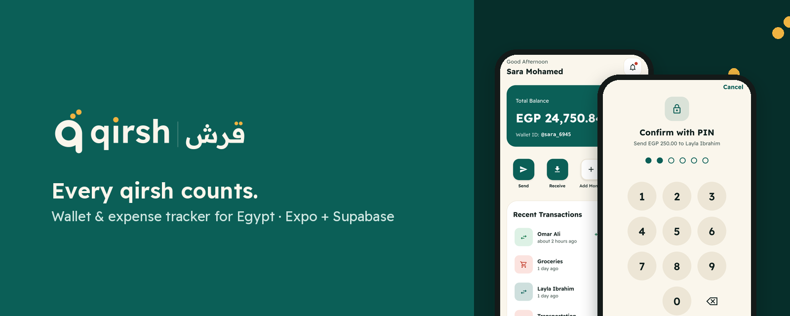
</p>

<p align="center">
  <b>Qirsh (قرش)</b> is a mobile wallet and expense tracker for Egypt: send money to friends, log spending against budgets, and see where every pound goes.
</p>

<p align="center">
  
  
  
  
  
</p>

<p align="center">
  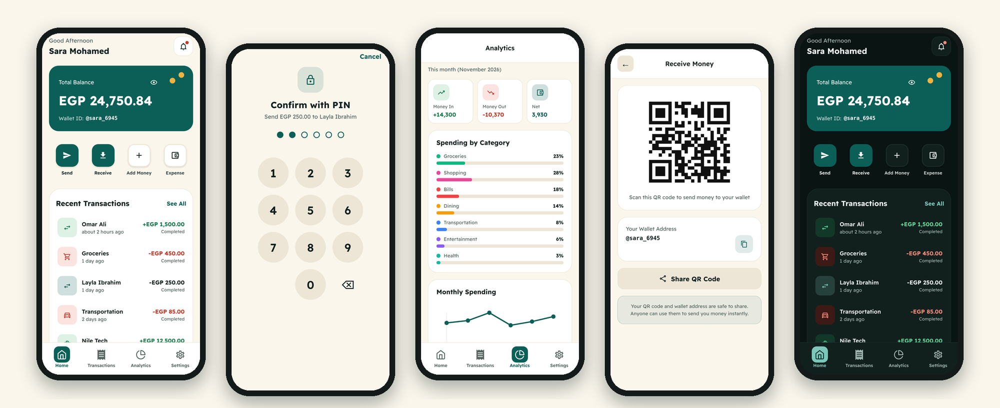
</p>

## Features

**Wallet**
- Live balance with hide/show, wallet ID (`@sara_6945`) and a QR code to receive money.
- Send money by wallet ID or email, or to recent contacts. You see the balance after the transfer before confirming.
- Every payment needs a **6-digit PIN**, or **fingerprint / Face ID** as a shortcut.
- The balance and transactions update **live** when someone sends you money.

**Expenses and budgets**
- Log expenses by category, paid from the wallet or in cash ("tracking only").
- Monthly budgets per category, with "budget left after this" before you confirm.

**Analytics**
- Money in, money out and net for the month, spending by category, and a 6-month trend.

**Experience**
- Light and dark themes, one bilingual typeface (Readex Pro) for English and Arabic, and loading, empty and error states with retry and pull-to-refresh on every screen.

## Send money in a few taps

<table>
  <tr>
    <td align="center" valign="top">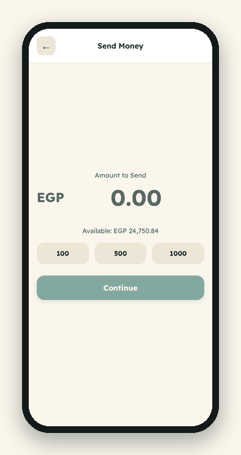</td>
    <td valign="top">
      <ol>
        <li><b>Amount</b>: the input only accepts valid money (2 decimals), shows the available balance, and blocks amounts over it.</li>
        <li><b>Recipient</b>: search any Qirsh user by exact wallet ID or email, or pick a recent contact.</li>
        <li><b>Confirm</b>: fee, total and balance after the transfer, plus an optional note.</li>
        <li><b>PIN</b>: the server checks the PIN and issues a one-time authorization for this single payment.</li>
      </ol>
      <p>The transfer itself is one database transaction: both wallets are locked, limits and balance are checked, the money moves and both ledger rows are written. It either all happens or none of it does.</p>
    </td>
  </tr>
</table>

## Engineering highlights

Most portfolio wallets are screens over mock data. Qirsh moves money for real, so the hard parts live in the database, where the app cannot get around them.

| What | How |
|---|---|
| **The client can't change money** | Balances and transactions are read-only to the app. Money only moves through `SECURITY DEFINER` Postgres functions (`send_money`, `add_expense`). |
| **Row-level security everywhere** | Every table has RLS; users can only read their own rows, and anonymous users get nothing. Contact names come from a narrow function that never exposes email. |
| **No race conditions** | Transfers lock both wallets in a fixed order (no deadlocks). Tested with 10 simultaneous sends against one balance: exactly the right number succeed and the total money in the system never changes. |
| **No double charges** | Each confirm screen sends an idempotency key; a double tap or a network retry returns the original transaction. |
| **Money is integers** | Amounts are stored and computed in cents (`bigint`); the UI parses and formats with tested helpers, never floats. |
| **Server-checked payment PIN** | bcrypt-hashed PIN, 5 attempts then a 15-minute lock, weak PINs rejected (`123456`, `111111`). A correct PIN yields a single-use token valid for 2 minutes; fingerprint unlock only releases the PIN saved in the device keychain, so the server still checks it. |
| **Limits** | Per-transfer and rolling 24-hour sending limits enforced in the database. |
| **Live updates** | Supabase Realtime pushes balance and transaction changes; React Query refreshes the affected screens. |

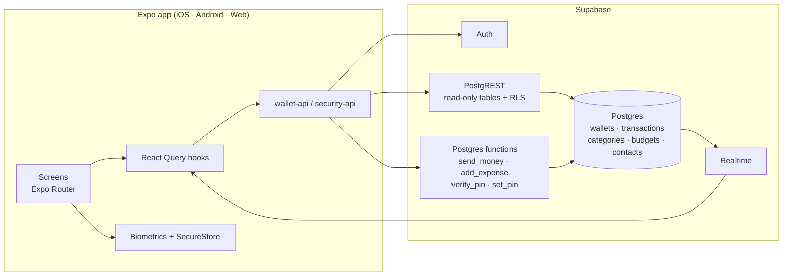

## Screenshots

| Sign in | Home | Transactions | Analytics |
|:-:|:-:|:-:|:-:|
| 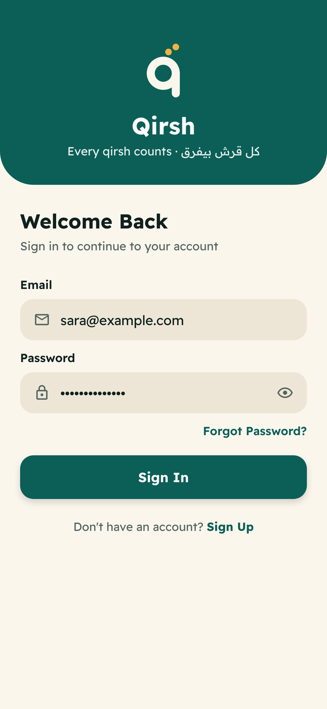 | 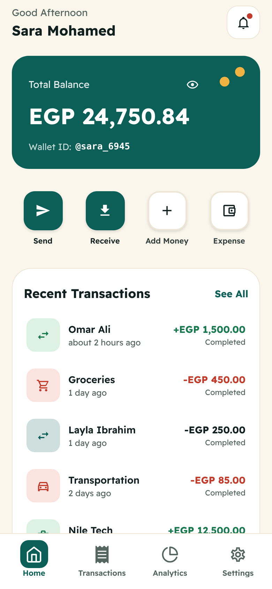 | 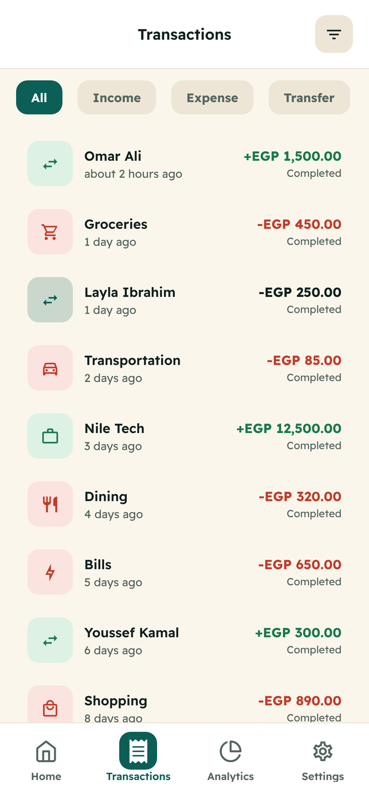 | 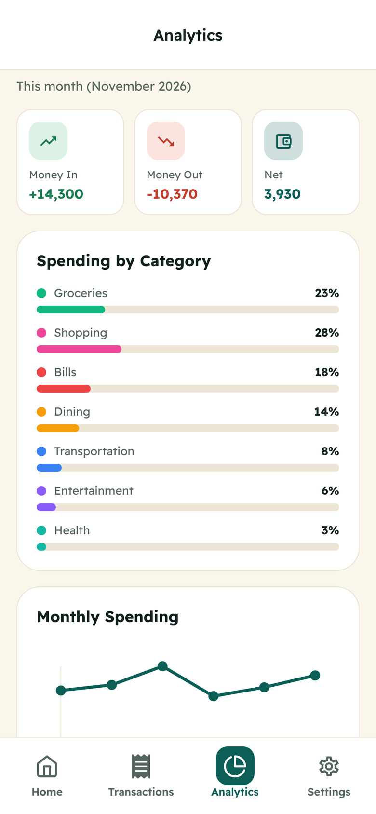 |
| **Receive** | **Add expense** | **Settings** | **Dark mode** |
| 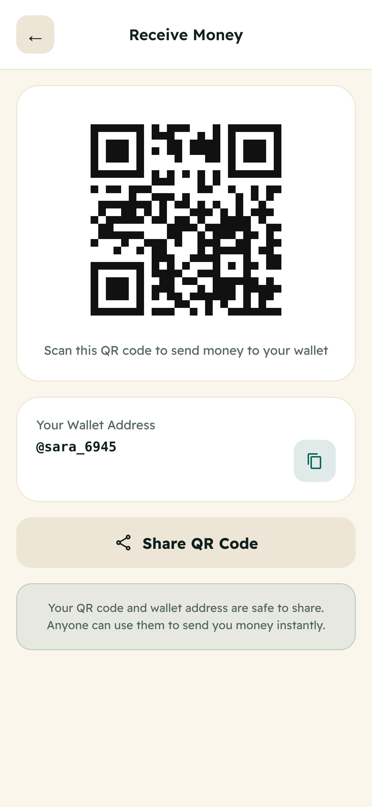 | 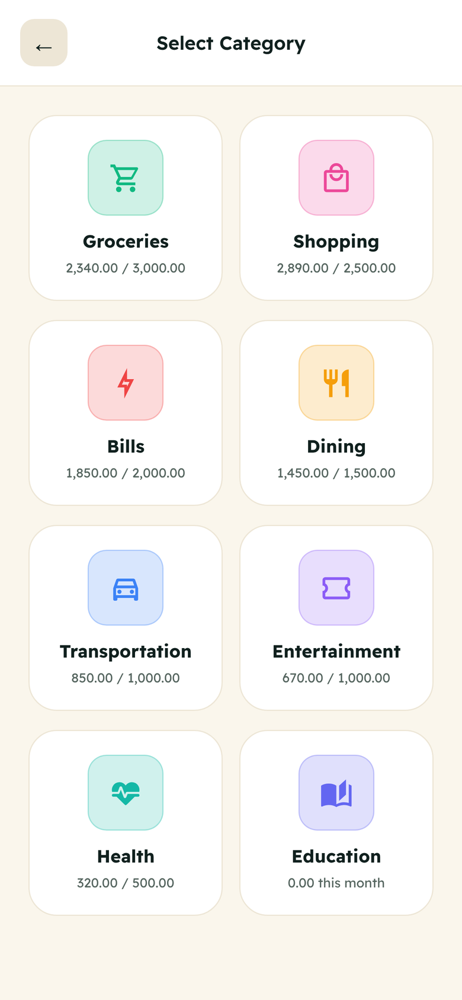 | 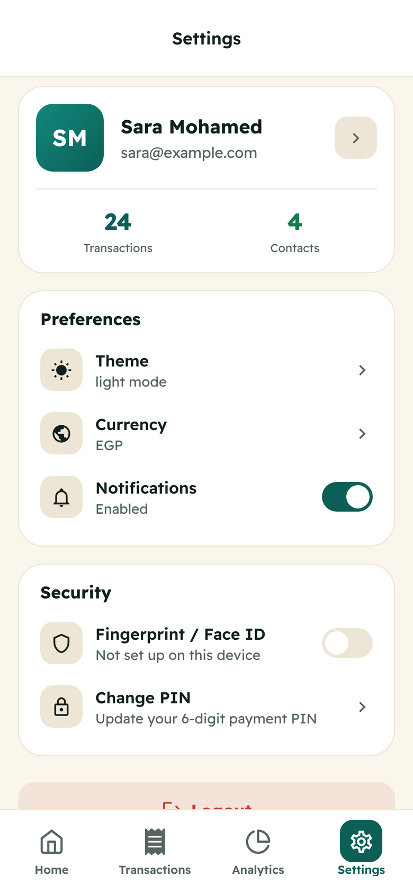 | 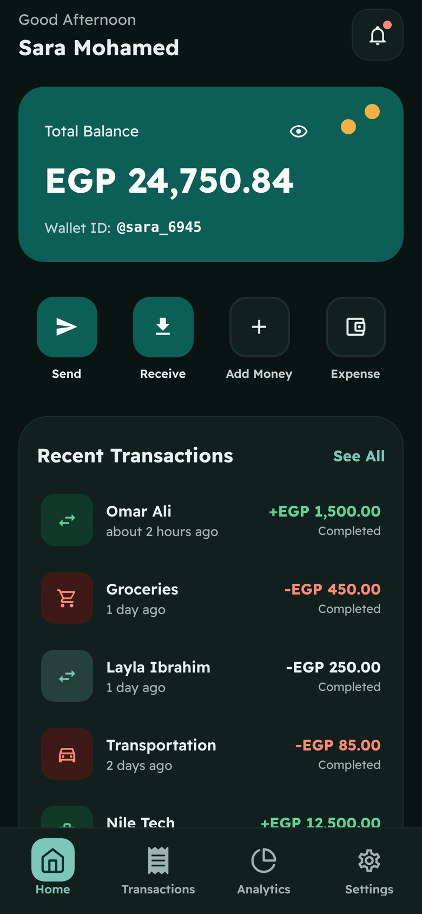 |

<sub>Screenshots are from the app's web build with demo data; names and amounts are placeholders.</sub>

## Tech stack

| Area | Choice |
|---|---|
| App | React Native 0.81, React 19, Expo SDK 54, Expo Router 6 (typed routes) |
| Data | Supabase (Postgres, Auth, Realtime), TanStack React Query, Zustand |
| Security | Row-level security, Postgres functions, pgcrypto (bcrypt), expo-local-authentication, expo-secure-store |
| UI | react-native-svg, Reanimated, expo-linear-gradient, react-native-qrcode-svg, Readex Pro |
| Language | TypeScript (strict) |

## Project structure

```
app/                      Routes (Expo Router): (auth) and (app)/(tabs)
src/
  screens/                Screen components (auth, home, send, analytics…)
  components/             Wallet UI, PIN pad, brand mark, Text wrapper (brand font)
  hooks/                  React Query hooks, PIN gate (PIN / biometrics → one-time token)
  services/               Supabase client, wallet-api, security-api, biometrics
  store/                  Session and theme (Zustand)
  utils/                  Money helpers (cents), theme palette
supabase/migrations/      Schema, RLS, money and PIN functions
branding/                 Logos, app icons, fonts, brand colours
```

## Getting started

**Requirements:** Node.js LTS, a [Supabase](https://supabase.com) project, and [Expo Go](https://expo.dev/go) or a development build.

```bash
git clone https://github.com/EsraaIsmaiel1/pay-wallet.git
cd pay-wallet
npm install
```

Create `.env` in the project root with your project's URL and publishable key (Supabase → Project Settings → API):

```bash
EXPO_PUBLIC_SUPABASE_URL=https://<project-ref>.supabase.co
EXPO_PUBLIC_SUPABASE_KEY=<publishable-or-anon-key>
```

Apply the database migrations (they create the tables, security rules, functions and default categories):

```bash
npx supabase login
npx supabase init
npx supabase link --project-ref <project-ref>
npx supabase db push --linked
```

Run the app:

```bash
npx expo start          # press a / i / w for Android, iOS or web
```

New accounts start at EGP 0.00. To try transfers, give a test wallet a balance in the Supabase SQL editor:

```sql
update wallets set balance_cents = 100000  -- EGP 1,000.00
where user_id = (select id from auth.users where email = 'you@example.com');
```

More detail on the database and its functions is in [`supabase/README.md`](supabase/README.md).

## Brand

Qirsh has its own identity: a lowercase **q** whose bowl is a coin, with the two dots of **ق** dropping in as gold coins. Nile green and coin gold on warm sand, set in Readex Pro. Logos, app icons, fonts and colours are in [`branding/`](branding/).

<p align="left"></p>

## Roadmap

- [x] Auth, wallet, transfers, expenses, budgets, analytics on Supabase
- [x] Payment PIN, biometrics, one-time payment authorization, sending limits
- [x] Brand identity, light and dark themes
- [ ] Add money through a payment provider (card, Fawry, InstaPay)
- [ ] Forgot password and PIN reset
- [ ] Downloadable receipts and push notifications for money received
- [ ] Full Arabic interface with right-to-left layout
- [ ] Automated tests and CI

---

<p align="center">Built by <a href="https://github.com/EsraaIsmaiel1">EsraaIsmaiel1</a></p>
